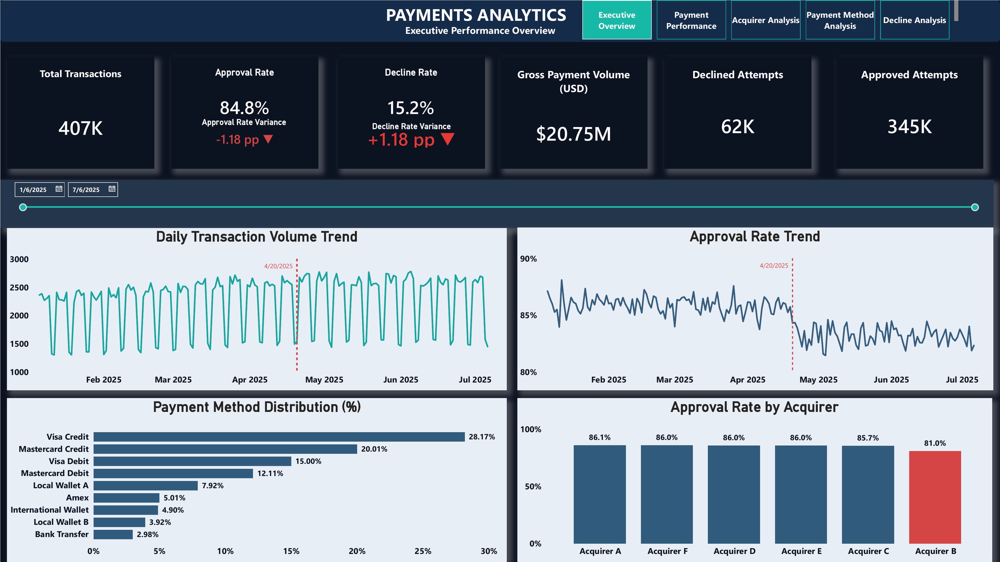
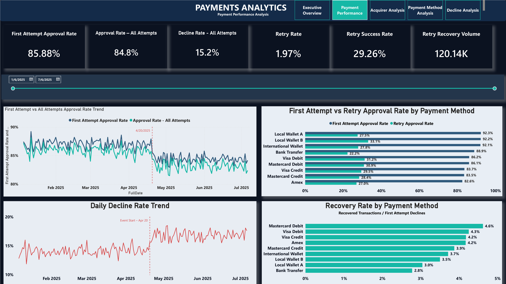
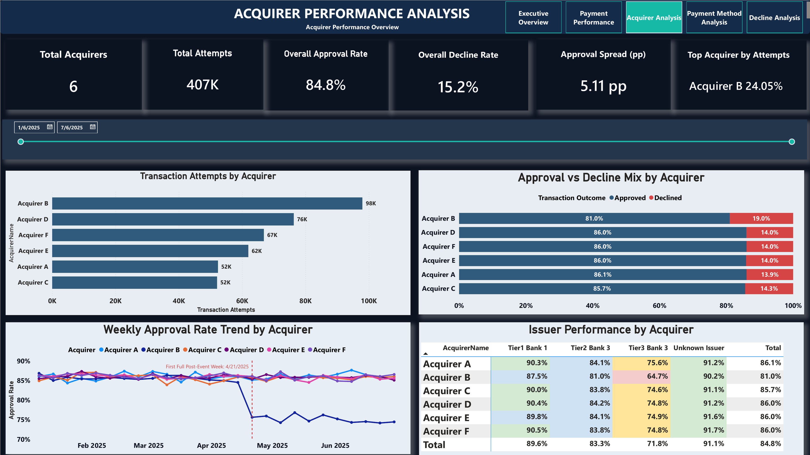
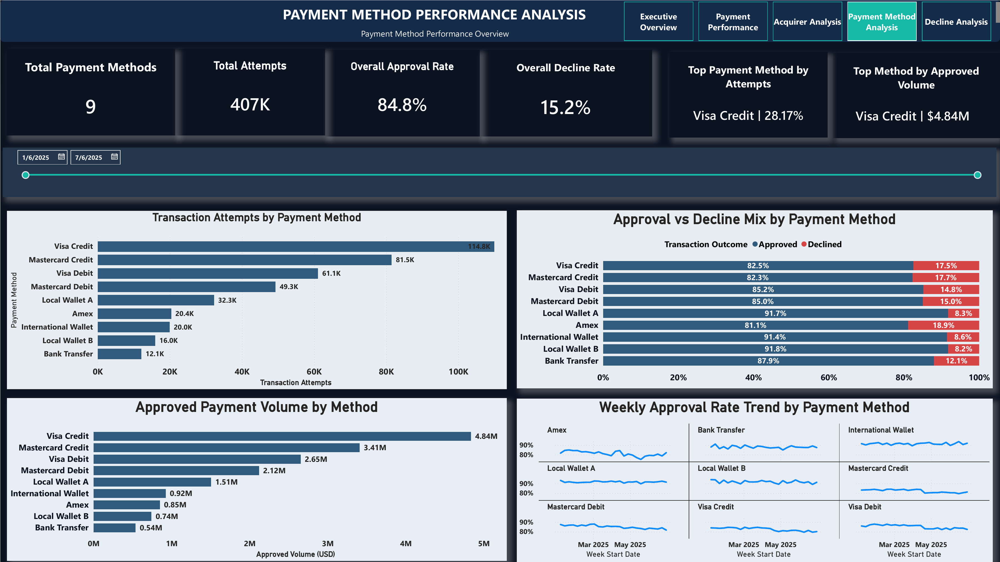
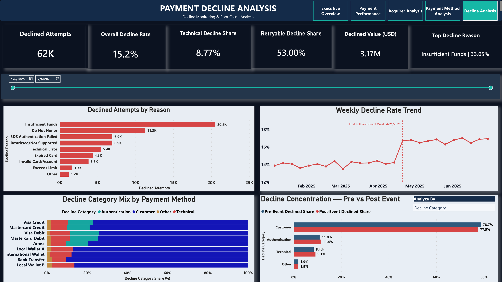
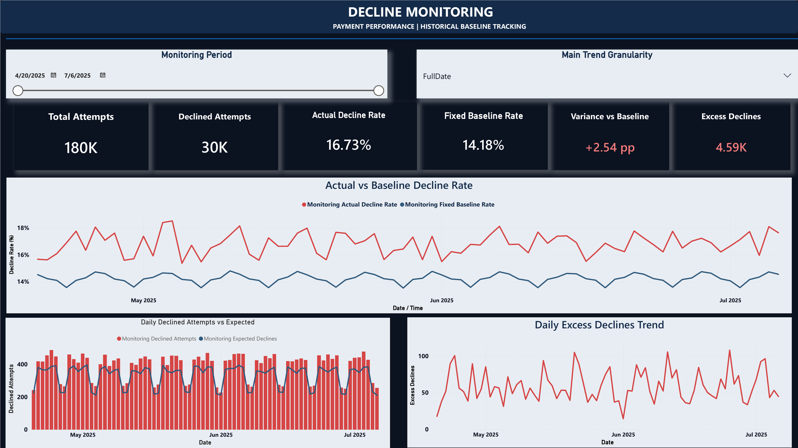

# Payments Analytics World

This project uses a synthetic payments dataset to investigate a decline in payment authorization performance between January 6 and July 6, 2025. I used SQL Server to identify when the decline started, examine the Acquirers, Routes, Issuers and decline patterns associated with it, and compare performance before and after the incident date. I then built a six-page Power BI dashboard to present the findings, explore the main areas of deterioration, and monitor decline rates against a historical baseline.

## Project at a glance

| Item | Details |
|---|---|
| Analysis period | January 6 – July 6, 2025 |
| Incident date | April 20, 2025 |
| Authorization attempts | 407,467 |
| Declined attempts | 62,102 |
| Overall Approval Rate | 84.76% |
| Overall Decline Rate | 15.24% |
| Approved payment volume | $17,586,539.01 |
| Acquirers / Routes | 6 / 18 |
| Payment methods / Merchants / Countries | 9 / 150 / 12 |
| Issuers represented in transaction records | 3 |
| Refund / Chargeback records | 8,539 / 1,526 |

Retries are included in the authorization-attempt analysis unless stated otherwise.

## Business Problem & Investigation Approach

The investigation started by identifying April 20, 2025 as the point when approval performance began to deteriorate.

I began by isolating declined attempts from the post-incident period (April 20 to July 6, 2025). Instead of investigating Countries, Payment Methods, Merchants, and other dimensions one by one, I screened the isolated attempts across seven dimensions in a single step: Acquirer, Route, Issuer, Payment Method, Merchant, Country, and Decline Reason.

I first used declined-attempt counts to identify where declined volume was concentrated. I then calculated each segment's share of all declined attempts within the same dimension. For example, each Acquirer's share was measured against all declined attempts across Acquirers, while each Route's share was measured against all declined attempts across Routes. This gave me a broad view of the main concentrations and helped shortlist the areas for further investigation.

A high count or share was not treated as evidence of poor performance. High-volume segments can naturally produce more declines, so I compared the shortlisted segments before and after the incident using Decline Rate, Transaction Mix, and Share of Total Declines. At portfolio level, I also compared average daily declined attempts to account for the different lengths of the two periods.

These comparisons pointed to Acquirer B and, within it, the Overflow Route as the main areas for further investigation. I then examined Issuer performance and decline categories within the affected Route. The investigation narrowed down where the deterioration was concentrated, but did not establish the operational root cause.

## Dataset & Data Model

I worked with a synthetic payments dataset covering authorization attempts from January 6 to July 6, 2025. It contains 407,467 attempts, including retries, as well as separate records for refunds and chargebacks.

I organized the data into fact and dimension tables:

| Table | What it contains |
|---|---|
| `FactTransactions` | Authorization attempts, amounts, timestamps, statuses, and payment-related keys |
| `FactRefunds` | Refund records linked to original transactions |
| `FactChargebacks` | Chargeback records |
| `DimDate` | Calendar and reporting attributes |
| `DimAcquirer` | Acquirer details |
| `DimRoute` | Route details and Acquirer relationship |
| `DimIssuer` | Issuer details |
| `DimMerchant` | Merchant details |
| `DimPaymentMethod` | Payment method details |
| `DimDeclineReason` | Decline codes, descriptions, categories, and retryability |
| `DimCountry` | Country details |
| `DimCustomer` | Customer attributes |

In `FactTransactions`, each row represents one authorization attempt. Retries are recorded as separate attempts, so they are included in the analysis unless stated otherwise. Refunds and chargebacks are stored separately, and their relationship with original transactions is not always one-to-one. I checked these relationships before using them in the analysis to avoid counting the same transaction more than once.

A few data checks were important:

- **Country mapping:** Every attempt has a `TransactionCountryID` that matches `DimCountry`. I used this key for country analysis instead of `CurrencyCode`, since all 12 countries have transactions in all 10 currencies.
- **Issuer coverage:** Three Issuer IDs appear in the transaction records. Another 80,320 attempts have no Issuer ID. I checked these records by Payment Method and found that they belong exclusively to Local Wallet A (32,253), International Wallet (19,954), Local Wallet B (15,968), and Bank Transfer (12,145). All card payment attempts have an Issuer ID. I kept these non-card transactions in the analysis without assigning an Issuer. Their share of total attempts was similar before and after the incident (19.84% and 19.56%).
- **Refund linkage:** All 8,539 refund records were linked to approved transactions: 8,470 to first attempts and 69 to retries. These are refund records, not confirmed lost revenue.
- **Chargeback linkage:** The 1,526 chargeback records were linked to 1,012 distinct approved transactions. Of these, 1,518 were linked to first attempts and 8 to retries. A transaction can therefore have more than one chargeback record.

## Key Findings

### 1. Approval performance deteriorated at portfolio level

Comparing the pre-incident period (January 6 to April 19; 104 days) with the post-incident period (April 20 to July 6; 78 days), the overall Approval Rate fell from 85.94% to 83.27% (-2.67 percentage points). Average daily declined attempts increased from approximately 307 to 387, a rise of around 26%.

### 2. Acquirer B showed the largest deterioration

Acquirer B's Approval Rate fell from 85.66% to 75.16% (-10.49 pp), while its share of total declines increased from 24.39% to 35.97%. Its transaction traffic share remained almost unchanged (23.9% to 24.2%), indicating that the change was not simply driven by higher traffic volume.

### 3. Acquirer B's Overflow Route became the main area of concern

Overflow Route attempts increased from 5,423 to 30,872, raising its share of Acquirer B's traffic from 9.99% to 70.66%. Its Approval Rate fell from 83.79% to 70.86% (-12.93 pp), and its share of Acquirer B's declines rose from 11.28% to 82.90%.

The Primary Route remained relatively stable, with Approval Rate moving from 85.99% to 85.62%. This identifies the Overflow Route as the main area for further investigation, but does not establish the operational cause.

### 4. All three Issuers on the Overflow Route experienced lower Approval Rates

| Issuer | Pre-Event Approval Rate | Post-Event Approval Rate | Change |
|---|---:|---:|---:|
| Tier3 Bank 3 | 73.27% | 54.82% | -18.46 pp |
| Tier2 Bank 3 | 82.24% | 73.39% | -8.85 pp |
| Tier1 Bank 1 | 87.91% | 79.23% | -8.68 pp |

Tier3 Bank 3 had the largest decline, while its share of Overflow Route attempts increased from 17.87% to 36.60%. However, the deterioration affected all three Issuers from April 20.

### 5. Card payment methods were more affected than non-card methods

Decline Rates increased across the five card methods by 2.98 to 3.62 pp. Non-card methods were more stable: Local Wallet A increased by 0.35 pp, Local Wallet B by 0.93 pp, International Wallet decreased by 0.34 pp, and Bank Transfer increased by 0.57 pp.

### 6. The deterioration appeared across all Countries but varied by Merchant

All 12 Countries recorded higher Decline Rates, with increases ranging from 1.82 pp in Spain to 3.41 pp in Mexico.

Merchant performance was less uniform. Merchant 148 and Merchant 150 recorded the highest post-incident declined-attempt counts (1,960 and 1,906), with Decline Rate increases of 11.26 pp and 10.59 pp respectively. Among 60 Merchants with at least 100 post-incident declines, 14 experienced increases above 8 pp, while the other 46 changed by between -2.96 and +3.18 pp.

### 7. Decline categories highlighted the main pressure within the Overflow Route

Within Acquirer B's Overflow Route, the Customer category's share of attempts increased from 10.42% to 22.84% (+12.42 pp). Authentication increased by 0.77 pp, while Technical declines decreased from 4.22% to 3.60% of attempts.

Technical decline counts rose from 229 to 1,111 because of the sharp increase in Route traffic, not a higher Technical Decline Rate. At portfolio level, all nine recorded decline reasons had higher rates after the incident, led by Insufficient Funds (+0.69 pp) and Do Not Honor (+0.47 pp). No single reason explains most of the overall deterioration.

## Power BI Dashboard

I built a six-page Power BI report to present the investigation, moving from overall performance to more detailed analysis and historical monitoring.

| Page | What it covers |
|---|---|
| Executive Overview | Overall transaction volume, Approval Rate, Decline Rate, approved payment volume, and key performance trends |
| Payment Performance | First attempts, retries, retry outcomes, and recovery indicators |
| Acquirer Analysis | Acquirer performance, traffic distribution, weekly trends, and Issuer performance |
| Payment Method Analysis | Transaction volume, approval and decline performance, approved payment volume, and weekly trends by Payment Method |
| Decline Analysis | Decline KPIs, reasons and categories, weekly trends, and interactive Pre/Post incident decline concentration |
| Decline Monitoring | Actual Decline Rate compared with a historical baseline, daily expected versus actual declines, and excess declined attempts |

The `Decline Concentration - Pre vs Post Event` visual on the Decline Analysis page uses a Field Parameter to switch between Acquirer, Route, Issuer, Payment Method, Merchant, Country, Decline Reason, and Decline Category. For each period, it compares each segment's share of declined attempts within the selected dimension. This brings the screening idea from Q05 into the dashboard without requiring a separate visual for each dimension.

The final page compares performance during the post-incident period with a fixed historical baseline and highlights additional declined attempts. It is designed for historical analysis, not real-time monitoring or live alerts.

### Dashboard screenshots

| Executive Overview | Payment Performance |
|---|---|
|  |  |
| [Open image](POWER_BI/Screenshots/01_Executive_Overview.png) | [Open image](POWER_BI/Screenshots/02_Payment_Performance.png) |

| Acquirer Analysis | Payment Method Analysis |
|---|---|
|  |  |
| [Open image](POWER_BI/Screenshots/03_Acquirer_Analysis.png) | [Open image](POWER_BI/Screenshots/04_Payment_Method_Analysis.png) |

| Decline Analysis | Decline Monitoring |
|---|---|
|  |  |
| [Open image](POWER_BI/Screenshots/05_Decline_Analysis.png) | [Open image](POWER_BI/Screenshots/06_Decline_Monitoring.png) |

[Open the Power BI report](POWER_BI/Payment.pbix)

## Business Impact & Next Steps

The shift toward Acquirer B's Overflow Route, alongside its sharp decline in Approval Rate, raises a concern about payment completion. A larger share of attempts was being processed through a Route with weaker approval performance, potentially leading to more failed customer payments. However, the actual impact on customer conversion and merchant revenue was not measured in this analysis.

The findings identify where performance deteriorated, but they do not confirm why the traffic shifted or establish a definitive operational root cause.

Based on the analysis, I would prioritize the following actions:

1. **Review routing configuration:** Check Acquirer B's routing rules and any configuration changes around April 20, 2025.
2. **Investigate the traffic shift:** Determine why traffic moved from the Primary Route to the Overflow Route, including possible failover or capacity conditions.
3. **Review Issuer responses:** Obtain detailed Issuer response codes and investigate the deterioration across all three Issuers, particularly Tier3 Bank 3.
4. **Examine traffic composition:** Compare Merchant and Payment Method mix within the affected Route to assess whether changes in traffic composition contributed to the decline.
5. **Improve performance monitoring:** Track Approval Rate, Decline Rate, Route Mix, Issuer Mix, and retry outcomes together to identify similar deterioration earlier.

Further investigation would require routing history, processor logs, detailed Issuer response codes, and capacity or latency data.

## SQL Investigation & Query Inventory

The main SQL investigation is organized into 11 queries (Q01–Q11). One of its key parts was the approach used to narrow down the source of the decline.

Rather than investigating Countries, Payment Methods, Merchants, and other dimensions one by one, I first isolated declined attempts from the post-incident period (April 20 to July 6, 2025). I then used Q05 to screen these attempts across seven dimensions in a single query: Acquirer, Route, Issuer, Payment Method, Merchant, Country, and Decline Reason.

I used `CROSS APPLY` and `VALUES` to profile the dimensions in one query. For each segment, the query returned its declined-attempt count and its share of all declined attempts within the same dimension. The share was calculated independently for each dimension using a window calculation partitioned by dimension. This provided a broad view of where declines were concentrated and helped shortlist the segments for further investigation.

These were screening signals, not performance verdicts. The following queries validated the shortlisted areas through Pre/Post comparisons, including Decline Rate and Transaction Mix, rather than treating high decline concentration as proof of poor performance.

This approach also shaped the `Decline Concentration - Pre vs Post Event` visual on the Power BI Decline Analysis page. Using a Field Parameter, the same comparison can be explored across different dimensions without creating a separate visual for each one.

### Main SQL Query Inventory

| Query | Purpose |
|---|---|
| Q01 | Monthly Approval Rate Trend |
| Q02 | Weekly Approval Rate Trend |
| Q03 | Daily Approval Rate Trend |
| Q04 | Pre/Post Incident Performance |
| Q05 | Post-Incident Declined Attempts Profile — seven-dimension screening |
| Q06 | Acquirer Pre/Post Comparison |
| Q07 | Acquirer B Route Performance |
| Q08 | Issuer Analysis within Acquirer B's Overflow Route |
| Q09 | Daily Approval Rate Trend - Tier3 Bank 3 |
| Q10 | Daily Issuer Performance Comparison |
| Q11 | Pre/Post Decline Category Analysis - Acquirer B's Overflow Route |

I also used supplementary SQL queries to validate dashboard measures and compare performance across business dimensions. These checks support the analysis but are separate from the main Q01–Q11 investigation sequence.

The query files are available in the [SQL folder](SQL/).

## KPIs & Definitions

I used the following KPIs throughout the authorization investigation and Power BI dashboard. I kept performance rates separate from volume and concentration measures because they answer different business questions.

All calculations are expressed as percentages (×100).

| KPI | Calculation |
|---|---|
| Approval Rate | Approved attempts ÷ Total authorization attempts |
| Decline Rate | Declined attempts ÷ Total authorization attempts |
| Transaction Mix | Segment attempts ÷ Total attempts in the relevant comparison group |
| Share of Total Declines | Segment declined attempts ÷ All declined attempts in the relevant comparison group |
| Decline Reason Share | Attempts with a specific decline reason ÷ All declined attempts in the selected group |
| Technical Decline Share | Technical declined attempts ÷ All declined attempts in the selected group |
| Retryable Decline Share | Retryable declined attempts ÷ All declined attempts in the selected group |
| Decline Category Mix | Declined attempts in a category ÷ All declined attempts in the selected group |

The comparison group depends on the analysis. In Q05, Share of Total Declines was calculated separately within each dimension. In later Pre/Post comparisons, the denominator was based on the relevant portfolio or Acquirer-level group.

Approval Rate and Decline Rate are calculated at the authorization-attempt level, including retries. Transaction Mix measures traffic distribution, not performance. Share of Total Declines and the other decline-share measures show concentration, not the likelihood of an attempt being declined.

A percentage-point (pp) change is the difference between two rates expressed in percentage points. For example, a change from 85% to 82% is a decrease of 3 percentage points, not 3%.

## Tools & Repository Structure

### Tools Used

| Tool | How I used it |
|---|---|
| SQL Server 2022 | Data querying, analysis, aggregation, and validation |
| SQL Server Management Studio (SSMS) | Writing and executing SQL queries |
| Microsoft Excel | Reviewing and checking data during preparation |
| Power BI Desktop | Data modeling, DAX measures, interactive visuals, and report development |

### Repository Structure

```text
Payments-Analytics-World/
│
├── DATA/
│   ├── Dimension tables (9 CSV files)
│   └── Fact tables (3 CSV files)
│
├── SQL/
│   └── Investigation queries (Q01–Q11)
│
├── POWER_BI/
│   ├── Payment.pbix
│   └── Screenshots/
│       └── Six dashboard page exports
│
└── README.md
```

- [DATA](DATA/) — The dataset files used in the analysis.
- [SQL](SQL/) — The 11 main investigation queries.
- [POWER_BI](POWER_BI/) — The Power BI report and screenshots of all six pages.

## Project Status

- **SQL Investigation:** Completed (Q01–Q11), with supplementary validation queries.
- **Power BI Dashboard:** Completed — six report pages, with the PBIX file and screenshots included in the repository.
- **Investigation Outcome:** The main areas associated with the Approval Rate deterioration were identified. The operational root cause remains unconfirmed and requires additional evidence.
